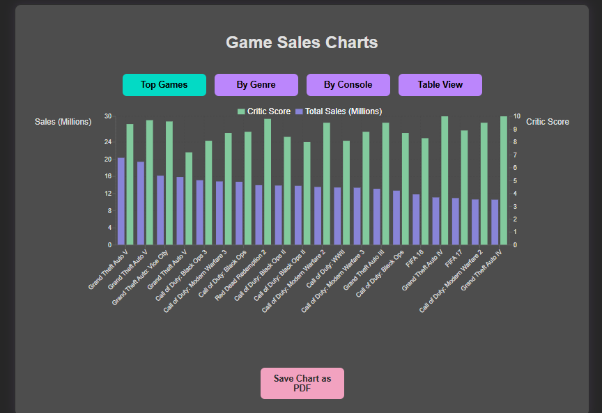
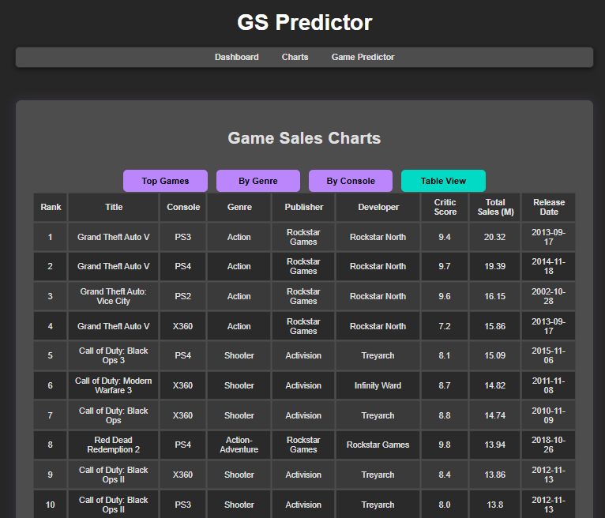
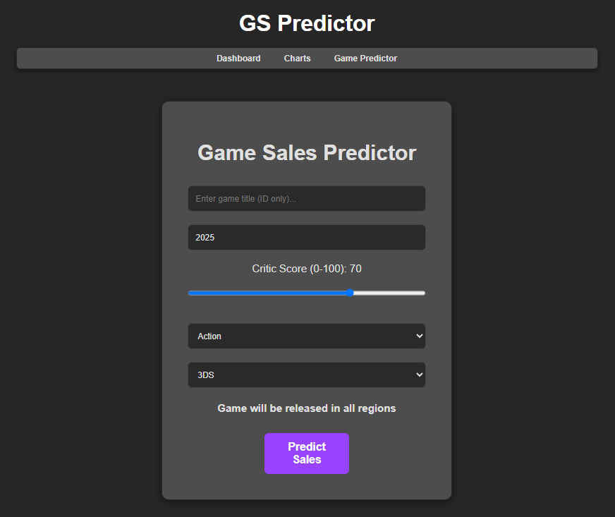
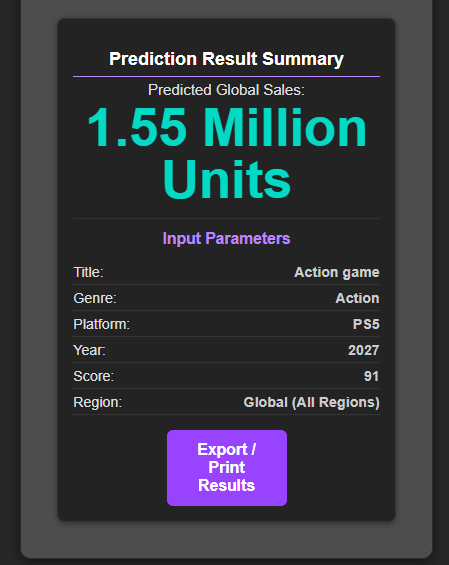

# Agile Project
Repository for agile processes group project game sales website & CSV 

# Video Game Sales Analysis & Prediction

A web application for exploring video game sales data and predicting the potential global sales of a game based on selected characteristics.

The application uses a dataset sourced from Kaggle, containing 21,344 cleaned game records. Users can explore sales trends through interactive charts, filter data by different categories, download visualisations as PDF files, and use a machine learning model to estimate the global sales of a game.

# Features

# Sales Data Visualisation

Explore video game sales data through interactive charts built with Recharts. Users can switch between different views of the dataset:

- Top Games: View the highest-selling video games.
- By Genre: Explore sales performance across different game genres.
- By Console: Compare sales across different gaming platforms.
- Top 20: View a table of the top 20 video games.

Each category uses a different chart type to present the data. Charts are interactive, allowing users to hover over data points to view additional information and sales figures.

# PDF Downloads

- Download individual charts as PDF files using jsPDF.
- Generate downloadable copies of the visualised sales data.

# Game Sales Predictor

The application includes a machine learning feature developed using Python and Scikit-learn to estimate the potential global sales of a video game.

The prediction system uses a Random Forest Regression model, trained on the prepared video game sales dataset.

Users can enter the following information:

- Game title
- Release year
- Critic score
- Genre
- Gaming platform

The application sends the selected information to a Python-based prediction API deployed using Firebase Cloud Functions. The API processes the inputs, prepares them for the trained model and returns an estimated global sales figure in millions of units.

The model was trained using an 80/20 training and testing split and consists of 50 decision trees. The trained model and its feature columns were saved using Joblib for use by the prediction API.

Additional logic accounts for the active lifespan of different gaming platforms. If a game is assigned a release year beyond its platform's last active year, a reduction is applied to the predicted sales figure.

Users can view their prediction results alongside the submitted game information and export or print the results.

# User Authentication

- User registration and login functionality.
- Firebase Authentication for account management.
- Guest account available for users who want to explore the application without registering.

# Dataset and Preparation

The project uses a video game sales dataset sourced from Kaggle.

The original dataset required cleaning and preparation before it could be used for analysis and machine learning. Records without sufficient information were removed, leaving 21,344 game records.

Python and Pandas were used to prepare the machine learning dataset. The preprocessing included:

- Identifying and removing columns with more than 50% missing values.
- Filling missing numerical values using median imputation.
- Filling missing categorical values using the most frequent value.
- Applying one-hot encoding to categorical features, including genre and console.
- Standardising numerical features using Scikit-learn's StandardScaler.

The processed dataset was exported to CSV for use in the machine learning workflow.

# Machine Learning Model

The project uses a Random Forest Regression model developed with Scikit-learn.

The training process includes:

- Loading the prepared dataset using Pandas.
- Creating additional features to indicate regional game releases.
- Separating the input features from the global sales values being predicted.
- Splitting the dataset into 80% training data and 20% testing data.
- Training a Random Forest Regressor using 50 decision trees.
- Saving the trained model and feature column names using Joblib.

The saved model is loaded by the Firebase Cloud Function, which receives prediction requests from the React application and returns the estimated sales figures.

# Technologies Used

 React - Front-end application 
 Vite - Development server and build tool 
 JavaScript / JSX - Application functionality and components 
 HTML / CSS - Web page structure and styling 
 Node.js / npm - JavaScript runtime and package management 
 Python - Data preparation and model development 
 Pandas - Dataset manipulation 
 Scikit-learn - Data preprocessing and Random Forest Regression 
 Joblib - Saving and loading the trained model 
 PapaParse - CSV processing 
 Recharts - Interactive data visualisation 
 jsPDF - PDF generation 
 Firebase Authentication - User registration and login 
 Firebase Cloud Functions - Hosting the prediction API 
 Git - Version control 

# Getting Started

# Prerequisites

- Node.js
- npm

# Installation

1. Clone the repository:

   git clone <repository-url>

2. Navigate to the project directory:

   cd <project-directory>

3. Install the project dependencies:

   npm install

4. Start the development server:

   npm run dev

5. Open the local URL provided in the terminal to access the application.

# Additional Dependencies

If dependencies are missing, the following packages can be installed:

npm install firebase
npm install papaparse recharts

# Firebase Configuration

Firebase configuration is required for user authentication and the prediction functionality.

The prediction API is deployed separately using Firebase Cloud Functions. Additional configuration and deployment requirements may apply when setting up the backend.

# Guest Account

A guest account is provided to allow users to explore the application without creating an account.

- **Username:** Guest
- **Email:** guest@email.com
- **Password:** Guest123

# Project Purpose

This project was developed as part of a college software development group project. It combines front-end web development, data preparation, interactive data visualisation, user authentication, API integration and machine learning within a single application.

# Screenshots

# Top games

# Table view

# Game sales predictor

# Game sales prediction summary

